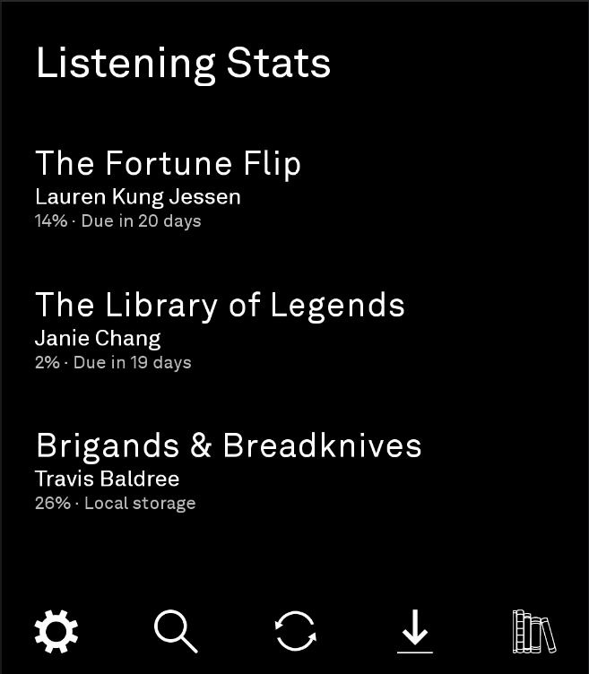
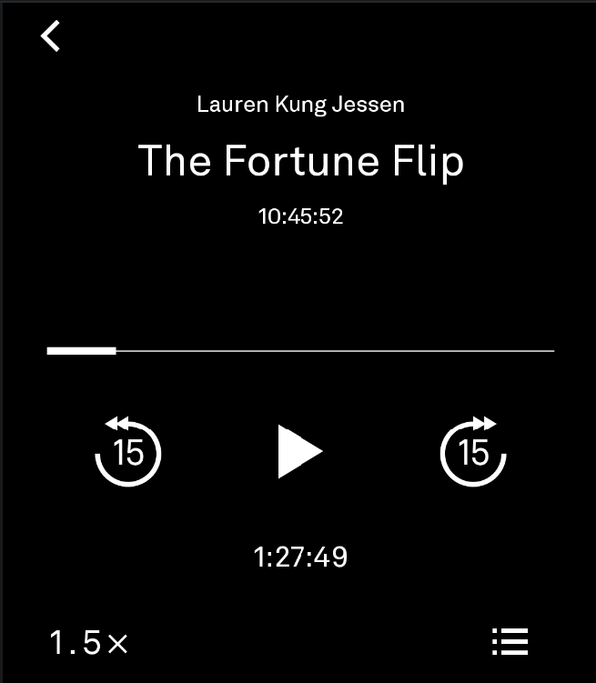
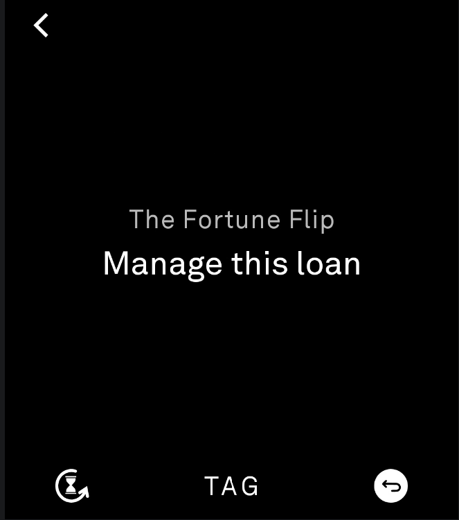
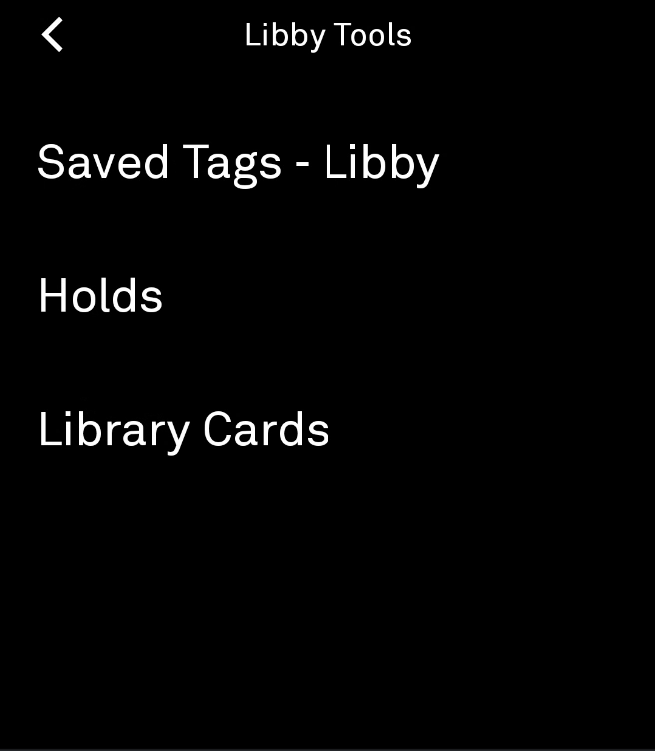
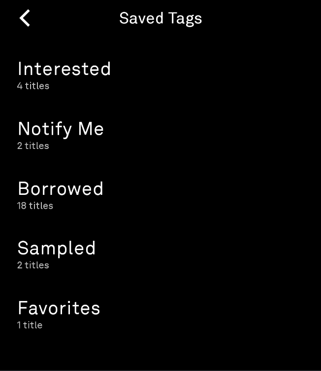
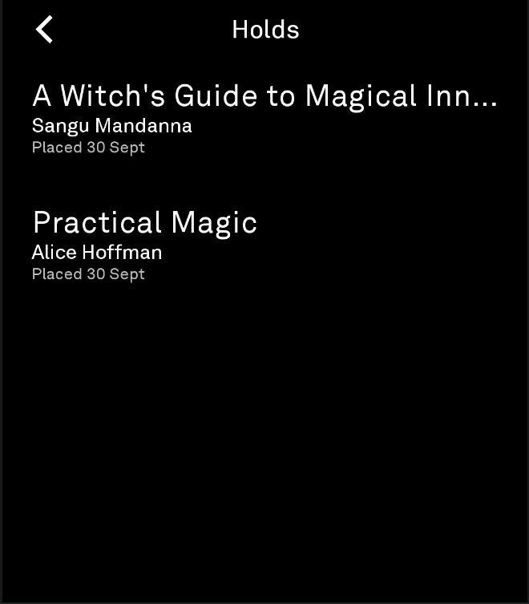
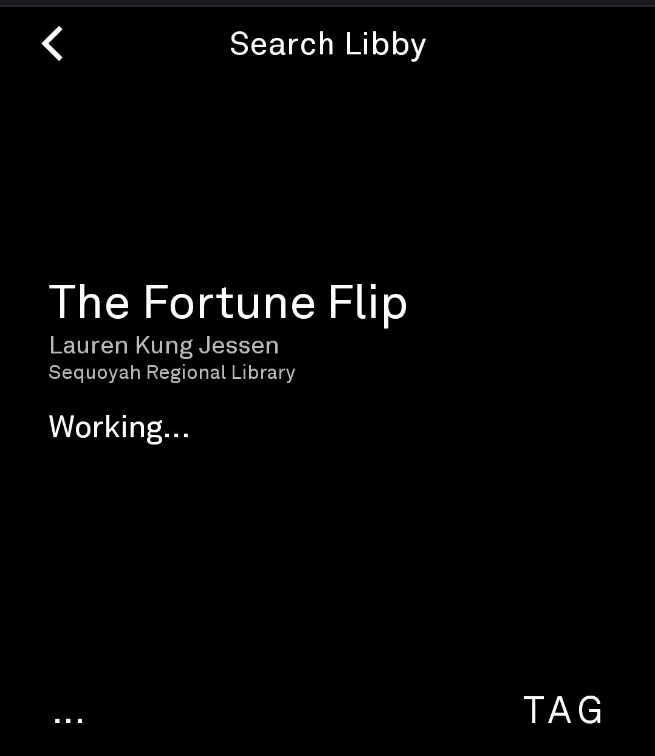
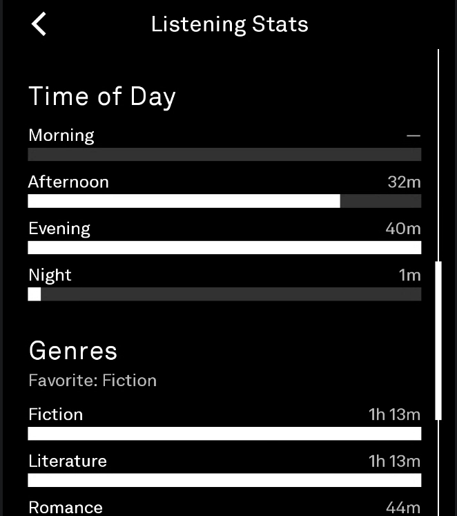
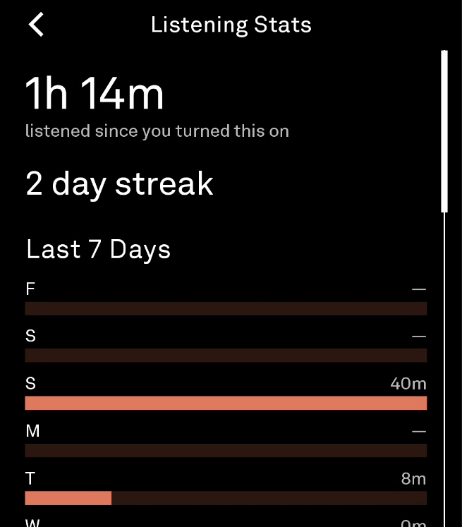
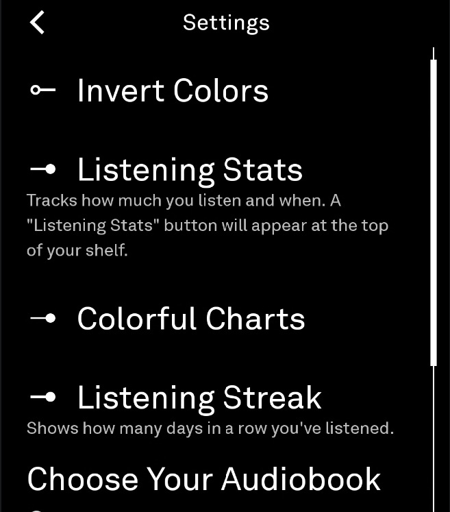

# Livrospeak

*A minimalist audiobook player for the Light Phone III.*

Livrospeak brings your local audiobooks and public library loans together into one calm, text-first library with a single player: no storefronts, no recommendations, no cover art, no account needed for the books you already own.

---

## Features

- **Local audiobooks:** single `.mp3` files or folder-based multi-file books, scanned straight from your device's shared `Audiobooks` folder. No cloud account, no app-private copies.
- **Public library loans:** optionally connect a Libby account so borrowed audiobooks appear right alongside your local library, using Libby's own official playback system.
- **One unified player:** every source shares the same player, controls, and native Android media-session integration (Bluetooth, lock screen, Light OS).
- **Background playback & resume:** pick up exactly where you left off, every time.

---

## Screenshots

<table>
  <tr>
    <td align="center"><br><strong>Books</strong></td>
    <td align="center"><br><strong>Player</strong></td>
  </tr>
  <tr>
    <td align="center"><br><strong>Manage a Loan</strong></td>
    <td align="center"><br><strong>Libby Tools</strong></td>
  </tr>
  <tr>
    <td align="center"><br><strong>Saved Tags</strong></td>
    <td align="center"><br><strong>Holds</strong></td>
  </tr>
  <tr>
    <td align="center"><br><strong>Search &amp; Tag</strong></td>
    <td align="center"><br><strong>Listening Stats</strong></td>
  </tr>
  <tr>
    <td align="center"><br><strong>Listening Stats</strong></td>
    <td align="center"><br><strong>Settings</strong></td>
  </tr>
</table>

---

## Usage

### Local Audiobooks

1. Connect your Light Phone III to your computer.
2. Create an `Audiobooks` folder in shared device storage if one doesn't exist yet.
3. Copy a single `.mp3` file directly into it (recommended – see the format note below), or create one folder per audiobook and place its audio files inside, numbered (`01`, `02`, …) so they play in order.
4. In Livrospeak: `Settings → Local Books → Scan for Books`.

Android may prompt for permission to read your audio library. Livrospeak never requests broad "All Files" access.

**A note on formats:** Livrospeak's local playback code handles MP3, M4B, and M4A identically, but only MP3 has been confirmed to actually play *on the Light Phone III itself*. M4B/M4A files that play fine on a computer or other Android hardware consistently fail to load there, which points to a missing AAC/MP4 decoder in the device's own media framework rather than anything specific to Livrospeak. Converting M4B/M4A audiobooks to MP3 before copying them over is the reliable path today.

### Public Library Loans

1. In Livrospeak: `Settings → Libby → Connect`.
2. On another device already signed into your Libby account, choose **Copy to Another Device**.
3. Enter the setup code Livrospeak displays.

Livrospeak automatically returns to your library once the session is authorized. Disconnecting only clears Livrospeak's own local session: your other authorized devices are unaffected.

Livrospeak maintains an application-scoped browser session for your library account and plays loans through the provider's own official playback system: it never extracts protected media files, bypasses DRM, or replaces the provider's player.

---

## Installation

### From Releases

Download the latest APK from this repo's Releases page and sideload it onto your Light Phone III.

You can also install and auto-update Livrospeak through [Obtainium](https://github.com/ImranR98/Obtainium) pointed at this repo's Releases, or through other Light Phone tool marketplaces.

### From Source

Requirements: JDK 17, Android Studio, Android SDK (API 36).

```bash
./gradlew assembleDebug
```

See `RELEASE.md` for release-signing instructions.

---

## Current Limitations

- M4B/M4A audiobooks aren't confirmed to play on the Light Phone III itself (see the format note above). MP3 is the reliable local format today.
- Chapter navigation is not currently supported, for either single-file or folder-based multi-file audiobooks.
- Public library setup currently requires a second, already-authorized device.
- Public library integration depends on the provider's own web app and may need updates if that changes.
- No ebook reading, cloud sync, metadata editing, or podcast-specific features.

---

## Known Issues

- **Tag state in Manage Loan doesn't always show "on":** when tagging a title you've already borrowed, the tag picker on the Manage Loan screen can fail to show a tag as already applied to it, even though it is. Still being tracked down.
- **Saved Tags occasionally drops a tag from the list:** very rarely, the Saved Tags screen renders without one of your tags, even though it's still there in your real Libby account. Reopening the screen generally brings it back.

---

## Privacy & Security

Livrospeak has no analytics, advertising, telemetry, or user accounts of its own. Local audiobooks stay on your device. When using public library loans, authentication and media delivery are handled entirely by the provider's own systems: Livrospeak never sees or stores your credentials.

Livrospeak publishes only display metadata (title, author, duration, playback state) to Android's native media session for Bluetooth/lock-screen controls. Credentials, cookies, URLs, and DRM-protected data never leave the app.

---

## Credits

Livrospeak began many iterations ago as an adaptation of **Bard**, an open-source Light Phone III audiobook player originally created by Stan Kornelsen ([sjkornelsen/bard](https://github.com/sjkornelsen/bard)). Livrospeak has since diverged substantially, but its foundations, and the legal language in the Disclaimer below, trace back to that project.

Livrospeak also incorporates selected UI resources from the **Light SDK**. The SDK's own README is kept in this repo as [README.light-sdk.md](README.light-sdk.md) for reference.

Full license texts and specifics for both are in [THIRD_PARTY_NOTICES.md](THIRD_PARTY_NOTICES.md).

---

## License

Livrospeak is licensed under the MIT License: see [LICENSE](LICENSE).

---

## Disclaimer

Livrospeak is an independent, unofficial project, not affiliated with, endorsed by, or approved by The Light Phone, Inc., OverDrive, Inc., or any public library system. Its optional library integration works only through your own authorized account and the provider's official systems: Livrospeak does not grant access to unborrowed books, redistribute DRM-protected content, or store your credentials. Compatibility with third-party services isn't guaranteed and may change as those services do; you're responsible for complying with their own terms.

Libby and OverDrive are trademarks of OverDrive, Inc. Light Phone and Light OS are trademarks of The Light Phone, Inc. Other trademarks belong to their respective owners and are used only to identify compatibility.
